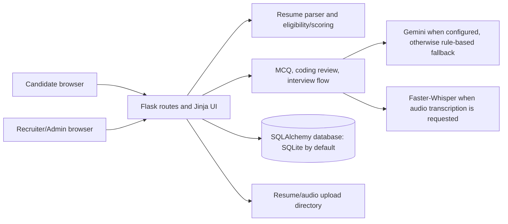

# AI Applicant Screening System — Final Project Report

> **Status key:** **Verified** means supported by automated tests or a previously run isolated workflow check. **Implemented, not fully verified** means code is present, but the full behavior or external service has not been confirmed. **Partial** means only part of the described feature is available. **Missing** means it is not implemented.

## Guide-ready summary

**Short explanation for the project guide:**

> My project is a Flask-based applicant screening system. Recruiters create jobs and configure eligibility requirements and assessment rounds. Candidates register, upload resumes, apply, and complete available assessments. The system extracts resume details, checks job criteria, calculates explainable round and weighted scores, and ranks applicants. Recruiters review the results and make the final selection. Gemini can assist interview questions and scoring when configured; without it, a clearly disclosed rule-based fallback is used.

**Candidate → System → Recruiter flow:**

Candidate registers and signs in → uploads a PDF/DOCX/TXT resume → system parses available details → candidate applies to a job → eligibility is checked → enabled rounds are completed → scores and job ranking are displayed → recruiter reviews the evidence and updates the application status.

**Input, processing, score, output:** Resume file and candidate answers → text/field extraction and rule-based eligibility checks → per-round marks and configured weighted score → eligibility reasons, scores, rank, status, recruiter dashboard, printable report, and CSV.

**Current delivery status:** Core web workflows and no-key fallback were verified using automated tests and isolated local checks. **Render has not been deployed or live-tested.** Gemini API calls have not been verified with a real key.

## 1. Project overview and abstract

The AI Applicant Screening System supports recruitment tasks in one web application: job posting, candidate applications, resume analysis, eligibility screening, assessments, interview practice, scoring, and recruiter review. It is intended to make applicant information and evaluation results easier to organize.

The system provides decision support, not an automatic hiring decision. Recruiters review candidates and control application statuses such as shortlisted or selected.

## 2. Problem statement and objectives

Recruiters may receive candidate information through separate resumes, tests, and interview notes, making comparison and progress tracking difficult. This project brings candidate profiles, job requirements, assessment results, and application decisions into a shared workflow.

Objectives:

- Provide candidate accounts and restricted recruiter/admin access.
- Accept resumes and extract useful candidate information.
- Compare resume evidence to configured job criteria.
- Support configurable MCQ rounds and a simple manually reviewed coding round.
- Calculate explainable round and overall scores and rank applicants by job.
- Let recruiters review candidates and record the final application status.

## 3. Proposed system and scope

This is a **single Flask web application** backed by SQLAlchemy, with Jinja-rendered pages and a relational database. It is not a trained applicant-classification model or a secure online code-execution platform.

**Implemented scope:** candidate and recruiter flows, resume parsing, job eligibility, aptitude/technical MCQ tests, manually scored coding submissions, interview question/answer scoring integration, weighted scores, ranking, dashboards, reports, and CSV export.

**Not included:** automatic hiring, secure code execution, proctoring, facial/emotion/personality analysis, or a deployed cloud service verified by this report.

## 4. Technologies and project structure

| Area | Actual implementation |
|---|---|
| Frontend | HTML/Jinja templates, CSS, JavaScript; Bootstrap and Chart.js appear in the UI |
| Web backend | Python 3, Flask, Flask-Login, Waitress |
| Data access | SQLAlchemy; SQLite by default, configurable with `DATABASE_URL` |
| Resume parsing | `pdfminer.six` for PDF, `docx2txt` for DOCX, Python text/regex/keyword extraction |
| Interview AI | Gemini SDK integration in `model.py`, with a rule-based fallback when the key/client is unavailable |
| Audio transcription | Faster-Whisper (`small`) is initialized on demand |
| Automated tests | pytest and unittest-style tests in `3. Deployment/tests/` |

Main folders:

- `3. Deployment/` — Flask app, scoring, database models, templates, static assets, parser, tests, and deployment configuration.
- `1. ASR/` — audio transcription experiments/utilities.
- `2. Model Training & Fine Tuning/` — training material and notebooks; these are not the live web app's interview-serving implementation.
- `4. Report & Pipeline/`, `5. References/` — project materials and references.

The live web application uses the Gemini integration/fallback and Faster-Whisper path described here. The Mistral/QLoRA material in the repository documentation is not evidence that a fine-tuned Mistral model is loaded by the current Flask application.

## 5. Architecture and workflow



1. A candidate registers and signs in. Public registration assigns the candidate role; administrator accounts are created using the trusted `flask --app app create-admin` CLI command.
2. The candidate uploads a resume on the signed-in interview/home page. Supported extensions are PDF, DOCX, and TXT; uploads have a 10 MB request limit and extension/content checks.
3. A recruiter creates a job, requirements, enabled rounds, and weights.
4. On application, the system records eligibility and an initial status. Candidates can take enabled assessments if the job's eligibility filter allows them.
5. The system refreshes round/final scores and ranks applications within the job. Recruiters review and change status; the system does not make the final hiring decision.

The application statuses available to recruiters are `Applied`, `Under Review`, `Shortlisted`, `Selected`, and `Rejected`. Eligibility (`Eligible` / `Not Eligible`) is recorded separately from recruiter decisions.

## 6. Roles and module status

| Module / role capability | Status | What the current implementation does |
|---|---|---|
| Candidate registration and login | **Verified** | Candidate registration, password hashing, login, and candidate-only role assignment; exercised in the isolated workflow. |
| Recruiter/admin access | **Implemented, not fully verified** | Recruiter/admin route guards exist; the CLI creates administrators. Public registration cannot assign elevated roles, and recruiter account provisioning is not a public workflow. |
| Candidate job browse and apply | **Verified** | Candidates can browse jobs and apply; eligibility and initial application status are stored. |
| Resume upload and parsing | **Verified** (TXT end-to-end; PDF/DOCX parser checks) | PDF/DOCX/TXT extraction is implemented. PDF and DOCX were checked at parser level; the full upload workflow used TXT. |
| Job management | **Verified** | Recruiter can create, edit, and delete jobs; job requirements and round settings are configurable. |
| Eligibility and missing skills | **Verified** | Reports eligible/not eligible and explanations for missing configured criteria. Skill matching uses keyword evidence and a small synonym map. |
| Aptitude and technical MCQ rounds | **Verified** for aptitude; technical route implemented | Recruiter-authored questions and automatic timed marking. The isolated end-to-end workflow exercised aptitude; technical MCQ attempt was not separately verified. |
| Coding round | **Verified** as manual-review workflow | Candidates submit Python/Java source; application never executes it. Recruiter enters marks manually. |
| Interview questions and scoring | **Verified** in no-key fallback; Gemini **not fully verified** | Follow-up generation and score persistence were exercised with the fallback; live Gemini requests require a valid key and compatible SDK/model/API. |
| Candidate/recruiter dashboards, ranking, report and CSV | **Verified** in isolated workflow | Dashboard routes, per-job leaderboard, HTML/printable report, and server-generated CSV were exercised. The dashboard's PDF action opens browser printing; it is not a server-generated PDF. |
| Render deployment | **Missing / not deployed** | Configuration is documented, but no Render build, live URL, or deployed workflow has been verified. |

“Verified” in this table refers to the stated scope of local automated/isolated checks, not a production deployment.

## 7. Resume processing, eligibility, and scoring

### Resume extraction

The parser extracts text and attempts to identify fields such as skills, contact details, education/degree, projects, certifications, and experience. Results are stored as structured JSON on the candidate record; a resume record also exists for interview compatibility. This is heuristic extraction: resume layout and wording affect what can be found.

### Eligibility

When a recruiter configures eligibility, the application checks required skills and any configured experience, education, and CGPA/percentage threshold. Missing requirements are reported as reasons. If eligibility filtering is enabled, an ineligible applicant starts with `Rejected`; an eligible applicant starts with `Under Review`. If filtering is disabled, the initial status is `Applied`, even though the system can still calculate and store eligibility information.

Skill matching is explicit keyword/synonym matching—not semantic embedding or a trained NLP classifier. The synonym map is small, so equivalent skills may be missed. CGPA/percentage comparisons use the supplied numeric values and do not normalize differing grading scales.

Interview results are associated with applications for the same candidate whose job title matches the interview session position. The implementation links by title rather than a unique application ID, so same-title applications may share an interview score.

### Scores and formulas

- **Resume score:** `100 × matched required skills / number of required skills`. The matcher uses parsed skills and resume text with its built-in equivalences. A candidate with no resume is left unscored in final-score refresh. A present resume with no required skills can receive 100 for resume screening.
- **MCQ score:** `100 × marks earned / maximum marks`. A late submission is recorded with a score of zero. Candidate answers are evaluated server-side.
- **Coding score:** recruiter-entered marks are normalized against each problem's maximum; multiple scored submissions are averaged. Code is stored but never executed.
- **Interview score:** per-answer ratings have three 1–10 fields (technical/content accuracy, communication/relevance, problem-solving/completeness). Their average is converted to a 0–100 score across saved interview answers. These ratings are AI-generated only when Gemini is successfully used; the fallback is a text/length heuristic and explicitly does **not** establish technical correctness.
- **Final score:** weighted mean of enabled rounds for which a score exists: `sum(round score × configured weight) / sum(configured weights for scored rounds)`. Missing/uncompleted rounds are excluded and the remaining weights are renormalized. If no enabled round has a score, final score is unavailable.
- **Default round configuration:** resume 20%, aptitude 20%, technical 20%, coding disabled at 0%, interview 40%. Recruiters can configure weights; enabled weights must sum to 100%, and disabled rounds must have weight 0%.
- **Ranking:** applications are ordered by final score within a job. Equal scores share a rank. Recruiters—not the formula—make selection decisions.

## 8. AI, NLP, and audio behavior

### Gemini and the no-key fallback

When configured, `model.py` calls the Google Gemini SDK using the model name `gemini-pro` for generated interview responses and requested answer ratings; a legacy grammar-feedback path also calls the same output function. The code is not a locally trained hiring model.

Without a key, with a placeholder key, or when `GenerativeModel` is missing, the code chooses deterministic fallback responses and bounded 1–10 heuristic ratings based on answer length, reasoning terms, and question-word overlap. It is not Gemini, does not verify technical correctness, and does not perform grammar correction. The no-key fallback has unit tests and was exercised in an isolated workflow.

**Not verified:** a live Gemini request. No API key was configured during the checks recorded here. The source dependency is pinned to `google-generativeai==0.3.0`, but live model availability, credentials, quotas, and API compatibility have not been tested.

### Audio and ML claims

Faster-Whisper's `small` model is initialized when transcription is requested; dependency/model download and live audio transcription were not verified in the final checks. Speaking pace uses word count divided by a fixed 10-second chunk duration and fixed thresholds. Do not claim that the current web app uses Mistral/QLoRA for its live interview responses unless that serving path is separately implemented and verified.

## 9. Database, storage, and security

Major SQLAlchemy entities include:

| Entity | Purpose |
|---|---|
| `User` | Login identity, password hash, and role |
| `Candidate` | Candidate profile and parsed resume data |
| `Resume` | Resume/interview compatibility record |
| `Job`, `JobApplication` | Requirements, round configuration, eligibility, scores, and status |
| `AssessmentQuestion`, `AssessmentAttempt` | Job MCQ banks and candidate results |
| `CodingProblem`, `CodingSubmission` | Coding prompts, stored source, and manual score |
| `InterviewSession`, `AIScore` | Interview session, answers, dimension ratings, and feedback |

The default database is `sqlite:///interview.db`; `DATABASE_URL` can override it. App startup calls schema initialization, including an SQLite compatibility upgrade path. Uploaded files are written under `UPLOAD_FOLDER`, defaulting to `uploads`. A filesystem path and SQLite database on an ephemeral host are not durable storage.

Implemented protections include hashed passwords, candidate-only public registration, role checks on recruiter routes, CSRF checks for unsafe HTTP methods, a 10 MB upload request limit, extension/magic-byte validation, and UUID-prefixed secure filenames. Production must set a strong `SECRET_KEY` and HTTPS cookie setting. The legacy logout route is GET and should be changed to POST for strict method safety.

## 10. Tests and verification results

Recorded local verification:

- `python -m pytest tests -q` from `3. Deployment`: **9 passed**.
- `python -m compileall -q app.py model.py tests`: passed.
- `python -m pip check`: no broken installed requirements.
- `git diff --check`: passed at the deployment-readiness checkpoint.
- Isolated local workflow exercised candidate registration/login, role restrictions, administrator/job/MCQ setup, resume upload/eligibility, aptitude score, no-key interview follow-up and score persistence, final score, leaderboard, candidate report, CSV, status update, and dashboards.
- Separate checks exercised job edit/delete, manual coding submission/score, and PDF/DOCX parser extraction.
- Waitress was started locally on an isolated port and returned HTTP 200.

Environment caveats for those checks: they ran under Python 3.8 and emitted dependency deprecation warnings. This machine did not have Python 3.11 installed, so a clean install under the configured Render runtime was not tested. No Gemini key or Render service was available.

## 11. Setup and deployment

For local setup, see [`3. Deployment/Readme.md`](3.%20Deployment/Readme.md). In brief, from PowerShell:

```powershell
cd "3. Deployment"
python -m venv .venv
.\.venv\Scripts\Activate.ps1
python -m pip install -r requirements.txt
python -m nltk.downloader stopwords wordnet
Copy-Item .env.example .env
python -m flask --app app create-admin
python app.py
```

Set a private `SECRET_KEY`; do not commit it. `GEMINI_API_KEY` is optional for the tested fallback. Waitress reads `HOST` and `PORT`; local defaults are `0.0.0.0` and `5000`.

### Render status and intended settings

**Render status: not deployed and not live-tested.** The documented settings are:

- Repository: `swaroopnadig/AI-Applicant-Screening-System`
- Branch: `agents/is-my-projects-rendering-complete`
- Root directory: `3. Deployment`
- Build: `pip install -r requirements.txt && python -m nltk.downloader stopwords wordnet`
- Start: `python app.py`
- Runtime: Python `3.11.9` from `runtime.txt`
- Environment: set a generated `SECRET_KEY`, set `SESSION_COOKIE_SECURE=True`; Render supplies `PORT`. `HOST`, `DATABASE_URL`, and `UPLOAD_FOLDER` may be left unset for ephemeral default paths. `GEMINI_API_KEY` is optional.

The free Render service has no persistent disk configured in the verified setup. SQLite records and uploaded resumes may be lost on restart, spin-down, or redeployment. Persistent disk configuration was described for a paid service, but was not provisioned or tested.

## 12. Limitations and prioritized unfinished work

1. **Deployment and durability:** deploy to Render, verify actual build/start logs and live flows; decide on persistent storage before using real applicants. Free-service local SQLite/uploads are not durable.
2. **Gemini:** test against the actual configured SDK, key, and currently available model; handle API/model failures explicitly. Until then, describe only the rule-based fallback as locally verified.
3. **Environment:** install and test the pinned dependencies under Python 3.11.9, not the available Python 3.8 environment.
4. **Assessment coverage:** separately verify the technical MCQ route and PDF/DOCX through the authenticated full upload flow; the recorded full workflow used aptitude and TXT.
5. **Audio:** test actual Faster-Whisper transcription and required model download in the deployment environment.
6. **Security hardening:** convert GET logout to POST; review production CSRF/session/security settings before real public use.
7. **Coding evaluation:** code execution is intentionally absent. Keep manual review, or design a separate isolated sandbox only if required.

## 13. Conclusion

The project currently provides a working local recruitment workflow with candidate and recruiter functions, heuristic resume analysis, eligibility checks, configurable MCQ/coding/interview rounds, explainable weighted scoring, rankings, and reports. Its scoring is decision support; hiring remains a recruiter decision. The no-key interview fallback is verified, while live Gemini and Render deployment remain unverified.

## 14. Viva preparation

### Five likely questions

1. **Is this a machine-learning hiring predictor?**

   No. Resume matching and the no-key fallback are rule-based. Gemini can assist interview question generation and answer ratings when configured; the project does not train a model that predicts hiring success.

2. **How is the final score calculated?**

   It is a weighted mean of enabled rounds that have completed scores. If some rounds are incomplete, only available-round weights are used and renormalized.

3. **What does resume analysis check?**

   It extracts text and attempts to identify candidate fields, then compares skills and configured experience, education, and CGPA/percentage criteria. The matching is heuristic and can miss unusual wording.

4. **Does the coding round run candidate code?**

   No. It stores Python/Java submissions for recruiter review. The recruiter enters a score manually; submitted code is not executed.

5. **Does the system select or hire candidates automatically?**

   No. It displays eligibility, scores, ranking, and application status. The recruiter makes the selection decision.
